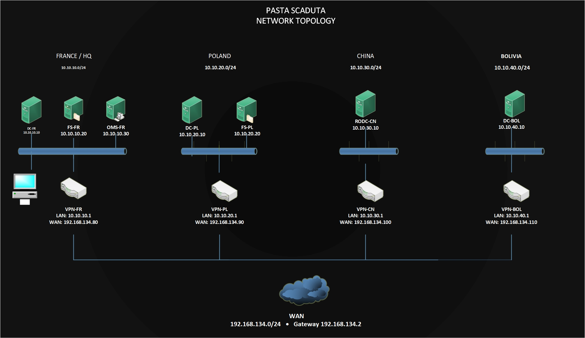

# Pasta Scaduta — Infrastructure Windows Server multi-sites

Projet pratique réalisé dans le cadre de ma formation à **SUPINFO** (module *Windows Server*).

## Présentation

L'objectif était de mettre en place l'infrastructure informatique d'une entreprise fictive, **Pasta Scaduta**, avec trois sites en France, en Pologne et en Chine. Un quatrième site, en Bolivie, représente une entreprise partenaire avec sa propre forêt Active Directory.

J'ai utilisé **Windows Server 2025** et **VMware Workstation** pour créer les machines virtuelles, configurer les réseaux et faire communiquer les différents services.

## Topologie réseau

La **France est le point central** des connexions VPN. Les sites distants sont reliés à **VPN-FR** par des tunnels **L2TP/IPsec** configurés avec RRAS.

| Site | Réseau local | Principaux serveurs |
| --- | --- | --- |
| France (siège) | `10.10.10.0/24` | VPN-FR, DC-FR, FS-FR, OMS-FR |
| Pologne | `10.10.20.0/24` | VPN-PL, DC-PL, FS-PL |
| Chine | `10.10.30.0/24` | VPN-CN, RODC-CN |
| Bolivie (partenaire) | `10.10.40.0/24` | VPN-BOL, DC-BOL |

Les interfaces WAN des routeurs utilisent le réseau NAT de VMware (`192.168.134.0/24`).

## Réalisations

- Installation et configuration d'**Active Directory Domain Services** et de **DNS** sur Windows Server 2025.
- Ajout d'un contrôleur de domaine en Pologne et d'un **RODC** en Chine.
- Configuration des **sites et sous-réseaux Active Directory**, puis vérification de la réplication.
- Mise en place des connexions **VPN site-à-site avec RRAS (L2TP/IPsec)** et des routes statiques.
- Création de partages **DFS** pour les services IT et Production, avec permissions et réplication entre la France et la Pologne.
- Configuration de **GPO** : mots de passe, déploiement de logiciels, restrictions, lecteurs réseau et personnalisation.
- Installation d'**IIS** en France et en Pologne, avec résolution DNS adaptée aux sites.
- Mise en place d'un serveur d'administration à distance **OMS-FR**.
- Création d'une forêt Active Directory distincte pour le partenaire bolivien et configuration d'une **relation d'approbation bidirectionnelle**.

## Vérifications

J'ai vérifié le fonctionnement des tunnels VPN, la réplication Active Directory, la synchronisation des dossiers DFS, les lecteurs réseau et l'application des GPO. J'ai également testé l'accès aux sites web internes depuis la France et la Pologne.

## Difficultés rencontrées

Pendant le projet, j'ai notamment résolu :

- Un problème d'affichage des interfaces **Demand-Dial** dans la console RRAS.
- Des arrêts très longs des serveurs utilisant RRAS, corrigés après activation d'un correctif via le registre Windows.
- Une erreur de modèles d'administration **ADMX/ADML**, résolue en installant les modèles officiels dans le *Central Store*.

Ces problèmes m'ont permis de pratiquer la recherche de causes, les tests et le dépannage d'une infrastructure Windows Server.

## Documentation

- [Rapport technique du projet (PDF)](Rapport_Pasta_Scaduta.pdf) — configuration, captures d'écran, tests et difficultés rencontrées.
- [Topologie réseau originale (Visio)](Topologie_Pasta_Scaduta.vsdx) — schéma modifiable.

*Projet pédagogique réalisé dans un environnement de laboratoire avec des adresses IP privées.*
